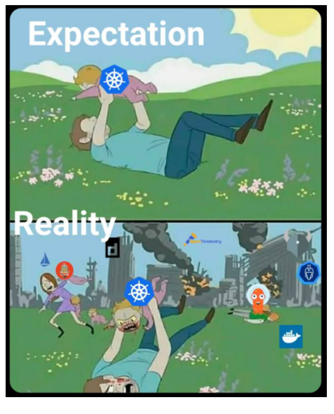

# 3.5.0 Introducción a Kubernetes

## ¿Qué es Kubernetes?

Una solución de orquestación de contenedores.

- **Κυβερνήτης** ("Kubernḗtēs") significa en griego "timonel" o "capitán". También se
  suele abreviar como **K8s** (la "8" sustituye a las ocho letras entre la "K" y la "s").
- Nace en 2014 en Google, basado en sus sistemas internos de orquestación **Borg** y
  **Omega**. Google libera una tercera plataforma completamente *open source* y la dona
  a la **CNCF** (Cloud Native Computing Foundation).
- Se libera una versión mayor cada pocos meses, y es hoy el proyecto con más
  contribuidores de todo el ecosistema *cloud native*, con empresas como Google, Red Hat
  o Microsoft entre los principales contribuidores.

## ¿Pero y qué es un contenedor?

Empaqueta el código y las dependencias de una aplicación.

- Este empaquetamiento se llama **imagen**, y se almacena en unos servidores que se
  llaman **registry**.
- La tecnología más conocida para construir estas imágenes es **Docker**, a partir de
  un fichero de definición (`Dockerfile`) como los que ya hemos usado en labs
  anteriores.

### Ejemplo: un `Dockerfile` básico y sus capas

Una imagen no es un bloque monolítico: está formada por una pila de **capas**
(*layers*) de solo lectura. Cada instrucción del `Dockerfile` que modifica el sistema
de ficheros (`FROM`, `COPY`, `RUN`, `ADD`...) genera una capa nueva encima de la
anterior. El resto de instrucciones (`WORKDIR`, `ENV`, `EXPOSE`, `CMD`...) solo añaden
metadatos a la imagen (o una capa vacía).

Veamos un ejemplo sencillo para una aplicación web en Python:

```dockerfile
# 1. Imagen base: ya trae sus propias capas (sistema operativo mínimo + Python)
FROM python:3.12-slim

# 2. Directorio de trabajo dentro del contenedor (metadato)
WORKDIR /app

# 3. Copiamos SOLO el fichero de dependencias (capa nueva, muy pequeña)
COPY requirements.txt .

# 4. Instalamos las dependencias (capa nueva, normalmente la más pesada)
RUN pip install --no-cache-dir -r requirements.txt

# 5. Copiamos el código de la aplicación (capa nueva, la que más cambia)
COPY . .

# 6. Metadatos: puerto que expone y comando de arranque
EXPOSE 8000
CMD ["python", "app.py"]
```

La imagen resultante se puede representar como una pila, donde cada capa solo guarda
las diferencias respecto a la de debajo:

```
┌──────────────────────────────────────────┐
│  Capa escribible del contenedor (r/w)    │  ← solo existe en ejecución
╞══════════════════════════════════════════╡
│  COPY . .            (código de la app)  │  ← cambia en cada commit
├──────────────────────────────────────────┤
│  RUN pip install ... (dependencias)      │  ← cambia rara vez
├──────────────────────────────────────────┤
│  COPY requirements.txt                   │
├──────────────────────────────────────────┤
│  FROM python:3.12-slim (varias capas)    │  ← compartida entre imágenes
└──────────────────────────────────────────┘
```

Algunas ideas clave:

- **Las capas son inmutables y se reutilizan.** Si diez imágenes parten de
  `python:3.12-slim`, esas capas base se descargan y almacenan **una sola vez** en el
  nodo. Esto es parte de lo que hace a los contenedores tan eficientes en disco y red.
- **Caché de construcción.** Al reconstruir la imagen, Docker reutiliza cada capa
  mientras ni la instrucción ni los ficheros que copia hayan cambiado. En cuanto una
  capa cambia, **todas las de encima se reconstruyen**.
- **El orden importa.** Por eso copiamos primero `requirements.txt` e instalamos las
  dependencias, y solo después copiamos el código: si únicamente tocamos `app.py`, la
  capa del `pip install` sale de caché y la construcción tarda segundos en lugar de
  minutos. Si hiciéramos `COPY . .` antes del `RUN pip install`, cualquier cambio en el
  código obligaría a reinstalar todas las dependencias.
- **Capa escribible.** Al arrancar un contenedor se añade encima una capa fina de
  lectura/escritura. Lo que el proceso escribe ahí se pierde al borrar el contenedor,
  por eso los datos persistentes deben ir a **volúmenes** (lo veremos en Kubernetes con
  los *PersistentVolumes*).
- **Borrar en una capa posterior no reduce el tamaño.** Si una capa añade un fichero
  y otra posterior lo elimina, el fichero sigue ocupando espacio en la capa original.
  Por eso se limpian las cachés en la misma instrucción `RUN` (p. ej. `--no-cache-dir`).

Podemos construir la imagen e inspeccionar sus capas con:

```bash
docker build -t mi-app:1.0 .
docker history mi-app:1.0   # lista cada capa, la instrucción que la creó y su tamaño
```

## ¿Cómo reduce recursos?

Como ya vimos en la [comparativa de virtualización](03-00-Virtualizacion-computo.md),
cada escalón (servidor físico → máquina virtual → motor de contenedores → orquestador
de contenedores) comparte más capas del sistema entre las distintas aplicaciones, lo
que reduce la sobrecarga de cada una de ellas a costa de aislarlas algo menos.

## ¿Qué aporta la contenerización?

El centro pasa a ser la **aplicación**, frente a la infraestructura:

1. Permite trocear la aplicación en piezas independientes (microservicios).
2. Portabilidad entre entornos y proveedores.
3. Consistencia entre entornos (desarrollo, *staging*, producción).
4. Aislamiento entre aplicaciones.
5. Despliegue rápido y escalabilidad.
6. Eficiencia en el uso de recursos.


## ¿Y por qué es importante Kubernetes?

- Es agnóstico respecto a la infraestructura sobre la que se ejecuta (puedes moverte
  entre proveedores cloud, o incluso on-premise).
- Tiene una comunidad y un ecosistema de herramientas muy activos.
- Cuenta con una adopción empresarial muy amplia.
- Se ha consolidado como la "plataforma de plataformas": la base sobre la que se
  construyen muchos servicios gestionados de los distintos proveedores cloud.

## ¿Es todo tan bonito?



Como suele pasar con cualquier tecnología con una curva de aprendizaje pronunciada, la
expectativa (una plataforma que gestiona todo de forma automática y transparente) y la
realidad (una configuración, mantenimiento y depuración que requieren bastante trabajo,
sobre todo al principio) no siempre coinciden. El ecosistema que rodea a Kubernetes
(la llamada *CNCF landscape*) es además enorme, con cientos de proyectos y
herramientas complementarias: no hace falta conocerlas todas, pero es bueno saber que
existen y que iremos viendo solo una pequeña parte en este curso.


En las siguientes secciones ([3.5 Kubernetes](03-05-K8S.md)) entraremos en el detalle
de los conceptos y piezas principales que forman un clúster de Kubernetes.
