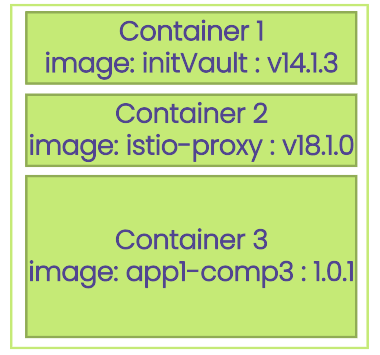
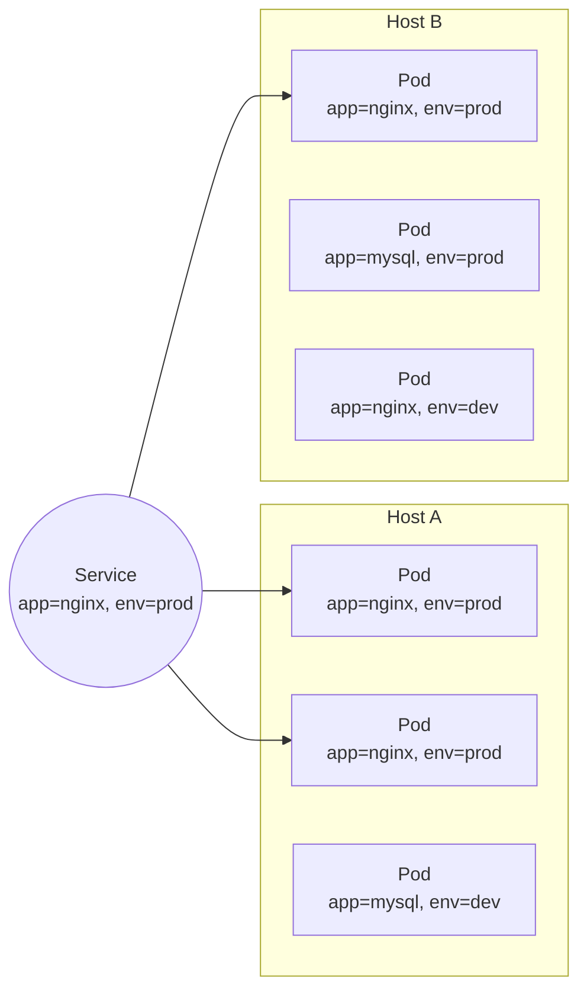
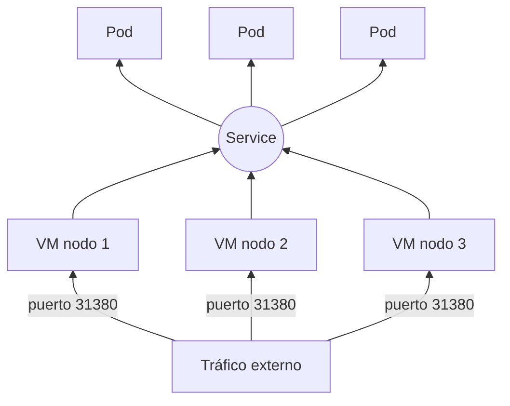

# 3.5 Kubernetes

## Antes de empezar: cómo probar los ejemplos

Todos los manifiestos de este capítulo están pensados para **copiarse y aplicarse tal
cual** en un clúster de Google Kubernetes Engine (GKE), por ejemplo el que creamos en el
[lab 07](https://github.com/AgustinICAI/asr-cloud-26/tree/main/07-k8s-init), incluso
con un único nodo `e2-small`.

```shell
# 1. Conectar kubectl con el clúster (sustituye el nombre y la zona por los tuyos)
gcloud container clusters get-credentials $CLUSTER_NAME --zone europe-southwest1-b

# 2. Comprobar que llegamos al clúster
kubectl get nodes
```

Para cada ejemplo, guarda el YAML en un fichero (el nombre que se indica en el
comentario de la primera línea) y aplícalo con:

```shell
kubectl apply -f <fichero>.yaml
```

> 💡 En lugar de crear un fichero también puedes pegar el YAML directamente con
> `kubectl apply -f - <<'EOF'` ... `EOF`.

Al final del capítulo hay una sección de [limpieza](#limpieza) para borrar todo lo
creado de una sola vez.

## Conceptos clave
### Namespace
- Agrupación de elementos en un mismo espacio. Principalmente Pods y Service, pero pueden existir otro tipo de objetos/recursos.
- Permiten trocear el cluster y tener los elementos ordenados.
- Si no indicamos nada, todo se crea en el namespace `default`.

```yaml
# namespace.yaml
apiVersion: v1
kind: Namespace
metadata:
  name: asr-demo
  labels:
    app: my-big-web-app
```

```shell
$ kubectl apply -f namespace.yaml
namespace/asr-demo created

$ kubectl get ns --show-labels
NAME              STATUS   AGE   LABELS
asr-demo          Active   6s    app=my-big-web-app,kubernetes.io/metadata.name=asr-demo
default           Active   11h   kubernetes.io/metadata.name=default
gke-managed-...   Active   11h   ...
kube-node-lease   Active   11h   kubernetes.io/metadata.name=kube-node-lease
kube-public       Active   11h   kubernetes.io/metadata.name=kube-public
kube-system       Active   11h   kubernetes.io/metadata.name=kube-system
```

En GKE verás además varios namespaces propios de Google (`gke-managed-*`,
`gmp-system`...) donde corren los componentes que gestiona el proveedor.

Para no tener que añadir `-n asr-demo` a cada comando, lo fijamos como namespace por
defecto del contexto actual. **Todos los ejemplos siguientes se crean en `asr-demo`**:

```shell
kubectl config set-context --current --namespace=asr-demo
```

### PODS

- Unidad atómica o "unidad de trabajo" más pequeña de Kubernetes.
- Los pods están formados por uno o MÁS contenedores que comparten volúmenes y configuración.
- SON EFÍMEROS

```yaml
# pod.yaml
apiVersion: v1
kind: Pod
metadata:
  name: pod-example
  labels:
    app: pod-example
spec:
  containers:
  - name: nginx
    image: nginx:stable-alpine
    ports:
    - containerPort: 80
```

```shell
$ kubectl apply -f pod.yaml
$ kubectl get pods -o wide            # estado, IP del pod y nodo donde corre
NAME          READY   STATUS    RESTARTS   AGE   IP           NODE
pod-example   1/1     Running   0          10s   10.52.0.12   gke-...-default-pool-...

# Redirigimos un puerto local al pod y probamos desde otra terminal
$ kubectl port-forward pod/pod-example 8080:80
$ curl -s localhost:8080 | grep title
<title>Welcome to nginx!</title>

$ kubectl logs pod-example            # logs del contenedor
$ kubectl exec -it pod-example -- sh  # abrir una shell dentro del contenedor
```

> 💡 En **Cloud Shell** no hace falta `curl`: el botón *Web Preview* → *Preview on
> port 8080* abre directamente el puerto redirigido en el navegador.

Un pod puede llevar más de un contenedor. Un caso muy habitual es el patrón *sidecar*:
además del contenedor principal de la aplicación, se añade otro contenedor auxiliar
que le da alguna capacidad extra (por ejemplo, un proxy de red como el que usa un
*service mesh* como Istio, o una inicialización de secretos):



Un ejemplo que puedes probar: un contenedor `nginx` sirve una página que otro
contenedor (`busybox`) regenera cada 5 segundos. Ambos comparten un volumen
`emptyDir` (un directorio temporal que vive lo mismo que el pod):

```yaml
# pod-sidecar.yaml
apiVersion: v1
kind: Pod
metadata:
  name: pod-sidecar
spec:
  volumes:
  - name: html
    emptyDir: {}
  containers:
  - name: nginx                     # contenedor principal: sirve la web
    image: nginx:stable-alpine
    ports:
    - containerPort: 80
    volumeMounts:
    - name: html
      mountPath: /usr/share/nginx/html
  - name: content-generator         # sidecar: genera el contenido
    image: busybox:1.36
    command: ["sh", "-c"]
    args:
    - while true; do
        echo "Hola desde el sidecar, son las $(date)" > /html/index.html;
        sleep 5;
      done
    volumeMounts:
    - name: html
      mountPath: /html
```

```shell
$ kubectl apply -f pod-sidecar.yaml
$ kubectl get pod pod-sidecar          # READY 2/2: dos contenedores en el mismo pod
NAME          READY   STATUS    RESTARTS   AGE
pod-sidecar   2/2     Running   0          15s

# El sidecar llega a nginx por localhost: comparten la misma IP (ver más abajo)
$ kubectl exec pod-sidecar -c content-generator -- wget -qO- localhost:80
Hola desde el sidecar, son las Wed Oct 15 17:30:05 UTC 2026
```

- Dentro de la especificación del contenedor dentro del yaml, este puede llevar más campos.
    - name: nombre del contenedor
    - image: la imagen del contenedor
    - ports: puertos a exponer, a los que se les puede asociar un nombre
    - env: array de variables de entorno a enchufar a nuestro contenedor

- Adicionalmente se introducen estos campos para gestionar los recursos:
    - request: reserva  de CPU y memoria realizada en el nodo donde corre. El
      *scheduler* solo coloca el pod en un nodo que tenga libre esa cantidad.
    - limit: limite que puede consumir del nodo si en este queda espacio no reservado por otros pods a través del request.
      Si el contenedor supera el límite de memoria, Kubernetes lo mata (`OOMKilled`);
      si supera el de CPU, simplemente se le ralentiza (*throttling*).
    - La CPU se mide en *milicores* (`250m` = un cuarto de vCPU) y la memoria en
      `Mi`/`Gi`.

```yaml
# pod-resources.yaml
apiVersion: v1
kind: Pod
metadata:
  name: frontend
spec:
  containers:
  - name: nginx
    image: nginx:stable-alpine
    ports:
    - containerPort: 80
      name: http
      protocol: TCP
    env:
    - name: MYVAR
      value: isAwesome
    resources:
      requests:
        memory: "64Mi"
        cpu: "100m"
      limits:
        memory: "128Mi"
        cpu: "200m"
```

```shell
$ kubectl apply -f pod-resources.yaml
$ kubectl exec frontend -- printenv MYVAR
isAwesome
$ kubectl describe pod frontend | grep -A6 Limits
    Limits:
      cpu:     200m
      memory:  128Mi
    Requests:
      cpu:      100m
      memory:   64Mi
```

- Y estos campos para gestionar la salud del contenedor (no son lo mismo, aunque se
  confunden a menudo):
    - **readinessProbe**: comprueba si el contenedor está listo para recibir tráfico.
      Mientras no pase la prueba, Kubernetes lo saca de los `Service` a los que
      pertenece (no le llegan peticiones), pero **no lo reinicia**.
    - **livenessProbe**: es la prueba de vida. Si el contenedor no la supera, Kubernetes
      lo reinicia para intentar solucionar el problema. Esto es lo que se conoce como
      *self-healing*.
    - **startupProbe** (no la vemos en detalle, pero es bueno saber que existe): pensada
      para contenedores con arranque lento; mientras no pase, desactiva las otras dos
      probes, evitando que Kubernetes mate un contenedor que simplemente tarda en
      arrancar.

Las comprobaciones pueden ser una petición HTTP (`httpGet`), una conexión TCP
(`tcpSocket`) o un comando dentro del contenedor (`exec`). Un ejemplo con un nginx
sano, que pasa ambas pruebas:

```yaml
# pod-probes.yaml
apiVersion: v1
kind: Pod
metadata:
  name: probes-http
spec:
  containers:
  - name: nginx
    image: nginx:stable-alpine
    ports:
    - containerPort: 80
    readinessProbe:            # ¿puede recibir tráfico?
      httpGet:
        path: /
        port: 80
      initialDelaySeconds: 2
      periodSeconds: 5
      failureThreshold: 2
    livenessProbe:             # ¿sigue vivo? si no, se reinicia
      httpGet:
        path: /
        port: 80
      initialDelaySeconds: 5
      periodSeconds: 10
      timeoutSeconds: 4
      failureThreshold: 3
```

Y un ejemplo para **ver el *self-healing* en acción**: el contenedor crea el fichero
`/tmp/healthy`, lo borra a los 30 segundos, y la `livenessProbe` comprueba que el
fichero existe. Cuando desaparece, Kubernetes reinicia el contenedor (y el ciclo
vuelve a empezar):

```yaml
# pod-liveness-fail.yaml
apiVersion: v1
kind: Pod
metadata:
  name: liveness-exec
spec:
  containers:
  - name: liveness
    image: busybox:1.36
    args:
    - /bin/sh
    - -c
    - touch /tmp/healthy; sleep 30; rm -f /tmp/healthy; sleep 600
    livenessProbe:
      exec:
        command: ["cat", "/tmp/healthy"]
      initialDelaySeconds: 5
      periodSeconds: 5
      failureThreshold: 3
```

```shell
$ kubectl apply -f pod-liveness-fail.yaml
$ kubectl get pod liveness-exec -w     # espera ~1 minuto y verás subir RESTARTS
NAME            READY   STATUS    RESTARTS      AGE
liveness-exec   1/1     Running   0             20s
liveness-exec   1/1     Running   1 (2s ago)    52s
$ kubectl describe pod liveness-exec | grep -i liveness
  Warning  Unhealthy  ...  Liveness probe failed: cat: can't open '/tmp/healthy': No such file or directory
  Normal   Killing    ...  Container liveness failed liveness probe, will be restarted
```

Los pods sueltos de esta sección ya no los necesitamos (los `Deployment` que veremos
después los gestionan por nosotros):

```shell
kubectl delete pod pod-example pod-sidecar frontend probes-http liveness-exec
```


## Comunicación de los contenedores y PODS
#### De contenedor a contenedor
Los contenedores de un pod comparten una IP. Permite la comunicación intrapod a través de localhost
(es lo que hemos hecho en el ejemplo del *sidecar* con `wget localhost:80`).

#### Pod-to-Pod
Cada pod tiene su propia IP dentro del clúster y cualquier pod puede hablar con
cualquier otro por esa IP. Pero, como los pods son efímeros, **su IP cambia** cada vez
que se recrean. Por eso no se usa directamente: se pone delante un **Service**, que
tiene una IP estable y un nombre DNS:

`<servicio>.<namespace>.svc.cluster.local`
```
# Ejemplo: service llamado data, en el namespace test
data.test.svc.cluster.local
```

Desde un pod del mismo namespace basta con el nombre corto (`data`); desde otro
namespace, `data.test`. Lo probaremos en cuanto creemos el primer Service.


### Services
- Método unificado de acceso a las cargas de trabajo expuestas por los Pods.
- No es un recurso efímero.
- Se pueden definir como:
    - IP estática del clúster (clusterIP), donde kubernetes le da un nombre DNS estático asociado también al namespace
    - Mismo puerto abierto en todos los nodos (NodePort)
    - Crea un balanceador dedicado para recibir y enviar el tráfico a los pods (LoadBalancer)

Un mismo Service puede repartir tráfico entre pods de varios hosts distintos, siempre
que compartan las mismas `labels` que su `selector`:



Para que los Services de los ejemplos tengan pods a los que enviar tráfico, primero
desplegamos 3 réplicas de nginx con las labels `app=nginx, env=prod` (el objeto
`Deployment` lo explicamos [más abajo](#deployment)):

```yaml
# deployment.yaml
apiVersion: apps/v1
kind: Deployment
metadata:
  name: nginx-deployment
  labels:
    app: nginx
spec:
  replicas: 3
  selector:
    matchLabels:
      app: nginx
      env: prod
  template:
    metadata:
      labels:
        app: nginx
        env: prod
    spec:
      containers:
      - name: nginx
        image: nginx:stable-alpine
        ports:
        - containerPort: 80
        resources:
          requests:
            cpu: "25m"
            memory: "32Mi"
```

```shell
$ kubectl apply -f deployment.yaml
$ kubectl get pods -l app=nginx,env=prod --show-labels
NAME                                READY   STATUS    RESTARTS   AGE   LABELS
nginx-deployment-7c79c4bf97-4kq2x   1/1     Running   0          12s   app=nginx,env=prod,pod-template-hash=7c79c4bf97
nginx-deployment-7c79c4bf97-9w8zd   1/1     Running   0          12s   app=nginx,env=prod,pod-template-hash=7c79c4bf97
nginx-deployment-7c79c4bf97-xb2lm   1/1     Running   0          12s   app=nginx,env=prod,pod-template-hash=7c79c4bf97
```

#### ClusterIP ejemplo
Es el por defecto, y la forma de enviar tráfico a los pods es usando el "selector" y definiendo el tag que tienen tus pods que quieres reenviar.
Solo es accesible **desde dentro** del clúster.

```yaml
# service-clusterip.yaml
apiVersion: v1
kind: Service
metadata:
  name: example-prod
spec:
  selector:
    app: nginx
    env: prod
  ports:
  - protocol: TCP
    port: 80        # puerto del Service
    targetPort: 80  # puerto del contenedor
```

```shell
$ kubectl apply -f service-clusterip.yaml
$ kubectl get service example-prod
NAME           TYPE        CLUSTER-IP     EXTERNAL-IP   PORT(S)   AGE
example-prod   ClusterIP   10.56.12.104   <none>        80/TCP    5s

# Los "endpoints" son las IPs de los pods que casan con el selector
$ kubectl get endpointslices -l kubernetes.io/service-name=example-prod

# Probamos el DNS del Service desde un pod temporal (se borra al salir por --rm).
# Debe imprimir el HTML de la página "Welcome to nginx!"
$ kubectl run tmp --rm -it --restart=Never --image=busybox:1.36 -- \
    wget -qO- http://example-prod.asr-demo.svc.cluster.local
```

#### LoadBalancer ejemplo
Extiende en realidad de un "service" de tipo NodePort. Está integrado con nuestro proveedor cloud para poder hacer esta asignación externa:
en GKE crea un balanceador de red de Google Cloud con una IP pública.

```yaml
# service-lb.yaml
apiVersion: v1
kind: Service
metadata:
  name: example-prod-lb
spec:
  type: LoadBalancer
  selector:
    app: nginx
    env: prod
  ports:
  - protocol: TCP
    port: 80
    targetPort: 80
```

```shell
$ kubectl apply -f service-lb.yaml
$ kubectl get service example-prod-lb -w   # EXTERNAL-IP pasa de <pending> a una IP (~1 min)
NAME              TYPE           CLUSTER-IP    EXTERNAL-IP    PORT(S)        AGE
example-prod-lb   LoadBalancer   10.56.7.201   <pending>      80:31380/TCP   5s
example-prod-lb   LoadBalancer   10.56.7.201   34.175.12.34   80:31380/TCP   52s

$ curl -s http://<EXTERNAL-IP> | grep title
<title>Welcome to nginx!</title>
```

Fíjate en `80:31380/TCP`: ese `31380` es el **NodePort** que Kubernetes ha abierto en
todos los nodos (se elige al azar en el rango 30000-32767), y es a donde envía el
tráfico el balanceador.

Permite de una forma cómoda exponer servicios fuera de nuestro cluster y usar los balanceadores del proveedor Cloud. En el siguiente esquema se abre un puerto en todos los nodos (por ejemplo, el 31380), y es el balanceador quien intentará enviar el tráfico a todos los nodos, aunque el health check hará que sólo termine enviando a los nodos donde haya pods corriendo:



> ⚠️ Cada Service `LoadBalancer` crea un balanceador **con coste** en GCP mientras
> exista. Bórralo en cuanto termines de probarlo: `kubectl delete service example-prod-lb`.


## Tipos de cargas de trabajo

### Replicaset
- Método principal de gestión de réplicas de pods y su ciclo de vida.
- Incluye su programación, escalado y eliminación.
- Su trabajo es sencillo: garantizar que siempre se está ejecutando el número de pods deseado.

`ReplicaSet → Pod`

- Usa el campo `replicas` para desplegar el número deseado de pods.
- El `selector` indica qué pods son "suyos", y el `template` es la plantilla (la misma
  `spec` de un Pod) con la que crea los que falten. Las labels del `template` **deben**
  casar con el `selector`.
- En la práctica, casi nunca se crea un `ReplicaSet` directamente: se gestiona a través
  de un `Deployment`, que es quien realmente usarás para desplegar aplicaciones.

```yaml
# replicaset.yaml
apiVersion: apps/v1
kind: ReplicaSet
metadata:
  name: rs-example
spec:
  replicas: 3
  selector:
    matchLabels:
      app: nginx-rs
  template:                 # plantilla del pod
    metadata:
      labels:
        app: nginx-rs
    spec:
      containers:
      - name: nginx
        image: nginx:stable-alpine
        ports:
        - containerPort: 80
        resources:
          requests:
            cpu: "25m"
            memory: "32Mi"
```

> Usamos `app: nginx-rs` (y no `app: nginx`) para que este ReplicaSet no se pelee
> por los pods del Deployment anterior.

Veamos cómo el ReplicaSet mantiene el número de réplicas aunque borremos un pod:

```shell
$ kubectl apply -f replicaset.yaml
$ kubectl get pods -l app=nginx-rs
NAME               READY   STATUS    RESTARTS   AGE
rs-example-5b8cr   1/1     Running   0          8s
rs-example-hx7lt   1/1     Running   0          8s
rs-example-q2wvd   1/1     Running   0          8s

$ kubectl delete pod rs-example-5b8cr      # usa el nombre de uno de tus pods
$ kubectl get pods -l app=nginx-rs         # ¡aparece uno nuevo para volver a 3!
NAME               READY   STATUS    RESTARTS   AGE
rs-example-hx7lt   1/1     Running   0          40s
rs-example-q2wvd   1/1     Running   0          40s
rs-example-tm9dn   1/1     Running   0          3s

$ kubectl scale replicaset rs-example --replicas=5
$ kubectl delete replicaset rs-example     # borra también sus pods
```


### Deployment
- Forma de gestionar los Pods mediante ReplicaSets.
- Proporcionar la funcionalidad de reversión y el control de las actualizaciones.
- Cada iteración crea una versión que se asigna tanto al ReplicaSet como a los siguientes Pods.

`Deployment → ReplicaSet → Pod`

El `nginx-deployment` que creamos [en la sección de Services](#services) ya es un
Deployment. Su manifiesto, de nuevo:

```yaml
# deployment.yaml
apiVersion: apps/v1
kind: Deployment
metadata:
  name: nginx-deployment
  labels:
    app: nginx
spec:
  replicas: 3
  selector:
    matchLabels:
      app: nginx
      env: prod
  template:
    metadata:
      labels:
        app: nginx
        env: prod
    spec:
      containers:
      - name: nginx
        image: nginx:stable-alpine
        ports:
        - containerPort: 80
        resources:
          requests:
            cpu: "25m"
            memory: "32Mi"
```

Podemos ver la cadena `Deployment → ReplicaSet → Pod` y escalarlo:

```shell
# La cadena completa
$ kubectl get deployment,replicaset,pods -l app=nginx

# Escalar
$ kubectl scale deployment nginx-deployment --replicas=5
```

> 💡 Lo habitual (y lo recomendable, por ser IaC) es cambiar las réplicas **en el
> fichero YAML** y volver a hacer `kubectl apply -f deployment.yaml`, en lugar de usar
> `kubectl scale`. El resultado es el mismo.


### Otras cargas de trabajo también indispensables aunque no entremos en detalle:
- Daemonset: permite desplegar el mismo pod en todos los nodos
- StatefulSet: diseñado para pods que tiene que tener un estado (aplicaciones stateful). Son aplicaciones que cada pod tiene que tener una identidad única y en caso de caida tiene que volver a llamarse igual.
- Jobs: contenedor que no tiene healthchecks porque muere una vez ejecutado. K8S no intenta volver a ejecutarlo si finaliza correctamente.
- CronJobs: lanzamiento planificado de jobs en el cluster

Por si quieres probar los dos últimos, son muy sencillos:

```yaml
# job.yaml
apiVersion: batch/v1
kind: Job
metadata:
  name: hello-job
spec:
  backoffLimit: 2            # reintentos si el contenedor FALLA
  template:
    spec:
      restartPolicy: Never   # obligatorio Never u OnFailure en un Job
      containers:
      - name: hello
        image: busybox:1.36
        command: ["sh", "-c", "echo 'Hola desde un Job'; sleep 5; echo 'Fin'"]
---
# El mismo trabajo, lanzado cada minuto
apiVersion: batch/v1
kind: CronJob
metadata:
  name: hello-cronjob
spec:
  schedule: "*/1 * * * *"    # sintaxis cron: cada minuto
  jobTemplate:
    spec:
      template:
        spec:
          restartPolicy: Never
          containers:
          - name: hello
            image: busybox:1.36
            command: ["sh", "-c", "date; echo 'Hola desde un CronJob'"]
```

```shell
$ kubectl apply -f job.yaml
$ kubectl get jobs                 # COMPLETIONS 1/1 cuando termina
$ kubectl logs job/hello-job
Hola desde un Job
Fin
$ kubectl get jobs -w              # cada minuto aparece un Job nuevo del CronJob
$ kubectl delete -f job.yaml
```

_Tampoco vemos en detalle los mecanismos de despliegue de un `Deployment` (los *rolling updates* que evitan pérdida de servicio al actualizar la imagen)._

## Limpieza

Como todo lo hemos creado dentro del namespace `asr-demo`, basta con borrarlo para
eliminar todos los objetos (pods, deployments, services, el balanceador...) de golpe:

```shell
kubectl delete namespace asr-demo
kubectl config set-context --current --namespace=default
```

Y si ya no vas a usar el clúster, bórralo para no consumir créditos:

```shell
gcloud container clusters delete $CLUSTER_NAME --zone europe-southwest1-b --quiet
```

## Visión general de la arquitectura

* **Cluster**: Cuando "desplegamos" con k8s, lo que estamos creando/obteniendo es un cluster. Un cluster no es más que un conjunto de VMs (nodos) que ejecutan aplicaciones contenerizadas. Todo cluster tiene al menos un nodo.

* **Node**: Como hemos comentado, un nodo es una instancia de una VM donde se sirven los contenedores de nuestras aplicaciones
* **Pod**: Un pod es una abstracción de k8s que representa un conjunto de contenedores que son servidos en un nodo
* **Control plane**: Se refiere a la capa de orquestación que expone la API e interfaces para definir, desplegar, y gestionar el ciclo de vida de los contenedores. En un entorno productivo, el **control plane** suele estar corriendo en varios nodos, lo que garantiza el servicio en caso de fallos.

Como resumen visual:


En GKE, el **control plane lo gestiona Google** y no corre en nuestros nodos: por eso
no veremos pods de `kube-apiserver`, `etcd` o `kube-scheduler`. Sí podemos ver
nuestros nodos y los componentes que corren en ellos:

```shell
kubectl get nodes -o wide              # las VMs (nodos) del clúster
kubectl get pods -n kube-system        # kube-proxy, DNS, agentes de logging/métricas...
kubectl cluster-info                   # dirección del API server gestionado
```


## Componentes del Control plane

#### kube-apiserver
- Proporciona un interfaz REST para interaccionar con el control-plane.
- Tanto las aplicaciones como los usuarios que desean modificar componentes de kubernetes, lo hacen a través del kube-apiserver.
- `kubectl` no es más que un cliente de esta API: con `kubectl get pods -v=6` puedes
  ver las peticiones HTTP que hace por debajo.

#### etcd
- `etcd` actúa como base de datos distribuida en varios nodos del clúster.
- Almacena los objetos e información de configuración de forma clave-valor.

#### kube-controller-manager
Supervisa el estado del clúster a través del apiserver y dirige el clúster hacia el estado deseado.
Existen controladores de:
- Nodos: para parar/reiniciar/crear nuevos nodos en caso de problemas
- Replicación: para asegurar que los pods se encuentran con las réplicas correctas (es lo que hemos visto al borrar un pod del ReplicaSet)
- Configuración de los objetos: que se encuentren desplegados los objetos deseados del cluster, como servicios, volumenes, configuración....

#### kube-scheduler
- Componente que observa los pods recién creados que no tienen un nodo asignado, seleccionando un nodo para que se ejecuten.
- Los factores que se tienen en cuenta para las decisiones de scheduling son los requisitos de recursos individuales y colectivos, las restricciones de hardware/software, las especificaciones de
afinidad y antiafinidad o la localización de los volumenes.
- Si ningún nodo tiene hueco para los `requests` de un pod, este se queda en estado
  `Pending` (lo verás con `kubectl describe pod`: `FailedScheduling ... Insufficient cpu`).

#### cloud-controller-manager
Integrado con el controller, es el componente que desencadena las acciones contra el proveedor cloud, creando/destruyendo nodos, balanceadores o volumenes de datos.
Es quien ha creado el balanceador de Google Cloud de nuestro Service `LoadBalancer`.

Si queréis seguir estudiando (no entra en el contenido del curso), siguientes puntos serían (y siguen siendo conceptos básicos):
- Gestión de configmaps, secrets en nuestros contenedores
- Gestión de volumenes persistentes, no persistentes: storageclasses, PV, PVCs
- Gestión de plantillas de aplicaciones: kustomize y helm
- Servidor de métricas y monitorización de PODS.
- Horizontal Pod Autoscaling (lo vemos en la [práctica de autoescalado](https://github.com/AgustinICAI/asr-cloud-26/tree/main/08-k8s-Entrega/ENTREGA1))
- GitOps: desplegar de forma declarativa desde Git en vez de con `kubectl apply` manual (lo vemos con ArgoCD en la [entrega 2 del lab 8](https://github.com/AgustinICAI/asr-cloud-26/tree/main/08-k8s-Entrega/ENTREGA2))
- Service mesh: gestión avanzada de tráfico entre servicios, p.ej. *canary releases* (lo vemos con Istio en la [entrega 3 del lab 8](https://github.com/AgustinICAI/asr-cloud-26/tree/main/08-k8s-Entrega/ENTREGA3))
